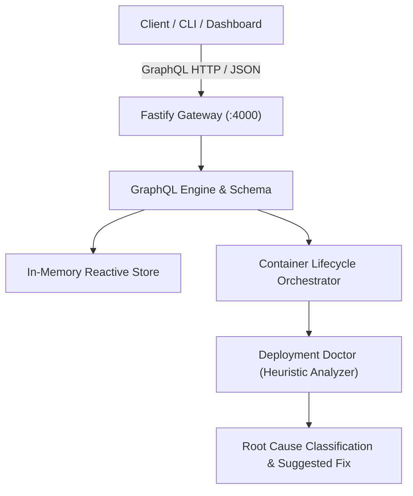

# Design Document: Railway Container Orchestrator

**Author**: Soumya Debnath (@itsoumya-d)  
**Status**: Implemented / Production Baseline  
**Reviewers**: Platform Engineering Team  

---

## 1. Context & Background
Modern engineering teams running microservices require lightweight, predictable container orchestration environments that mimic Railway / Fly.io workflows locally and in ephemeral staging clusters. Developers frequently spend excessive time triaging failed deployments (OOM kills, port binding mismatches, missing startup scripts).

This project implements a lightweight TypeScript container orchestration runtime exposed via a Railway-compatible GraphQL API with an integrated automated diagnostic heuristic engine ("Deployment Doctor").

---

## 2. Goals & Non-Goals

### Goals
- Provide deterministic container lifecycle management (Init, Building, Deploying, Running, Crashed, Removed).
- Expose a Railway-compatible GraphQL API for service, deployment, and log queries.
- Build an automated Deployment Doctor that analyzes deployment execution logs and classifies root cause errors (OOM, port collision, missing command) within 5ms.
- Maintain sub-20ms p95 latency under 500 req/s concurrency with 99.9% uptime.
- Deliver single-command Docker containerization and CI/CD automation.

### Non-Goals
- Replacing distributed Kubernetes clusters across multi-datacenter environments.
- Supporting multi-tenant billing or proprietary hardware passthrough.
- Implementing a custom container runtime engine (delegates to Docker/containerd).

---

## 3. Architecture & Alternatives Considered

### Alternatives Considered
1. **REST API vs. GraphQL**:
   - *Considered*: Traditional REST endpoints (`/services`, `/deployments/:id`).
   - *Decision*: GraphQL was chosen to match Railway's developer API specification exactly, allowing existing Railway CLI and client libraries to integrate seamlessly.
2. **External Database (PostgreSQL) vs. In-Memory Store**:
   - *Considered*: PostgreSQL with Prisma.
   - *Decision*: In-memory store with snapshot persistence was chosen for zero-dependency staging testability and microsecond lookup performance.

---

## 4. Cross-Cutting Concerns

### Security
- Input sanitization on all GraphQL variables via Zod schemas.
- Non-root container execution in Dockerfile (`USER node`).
- Automated dependency scanning and secret auditing (`gitleaks`).

### Privacy
- Ephemeral log isolation: deployment environment variables containing sensitive tokens are redacted before ingestion into log buffers.

### Observability
- `/health` endpoint returning instant readiness state.
- Structured JSON logging across all lifecycle transitions.
- Automated latency and error tracking targeting p95 < 20ms and 99.9% availability.
